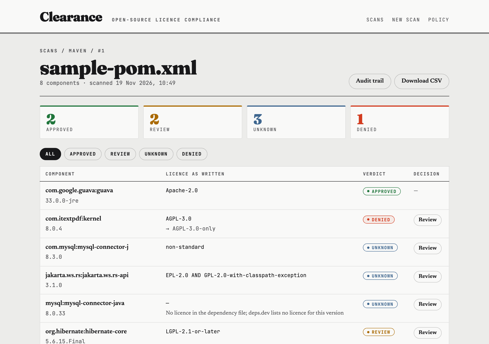
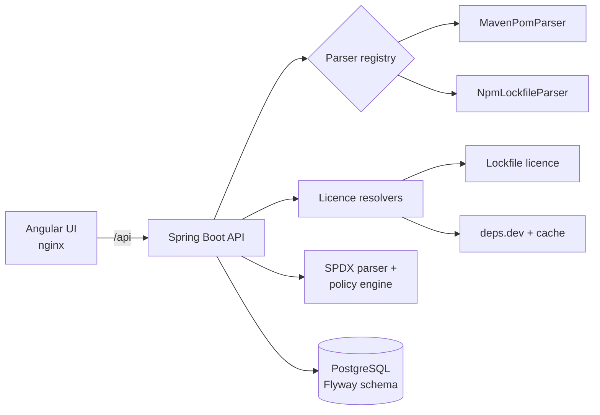

# Clearance

**An open-source licence compliance checker.** Upload a `pom.xml` or `package-lock.json` and you get:
- every dependency's licence;
- a verdict against a deny-first licence policy;
- a reviewer workflow with an append-only audit trail.

It's a small, real version of what a software supply-chain compliance team automates.



> Not legal advice. Clearance flags licences for a human to review; it does not decide what is legal.

## Run it

```bash
docker compose up --build
```

Open <http://localhost:8080> and upload [`samples/pom.xml`](samples/pom.xml) or [`samples/package-lock.json`](samples/package-lock.json). Each one produces at least one APPROVED, REVIEW, UNKNOWN and DENIED component. Licences are looked up live on deps.dev, so this needs internet access.

## How it works



1. **Parse.** The parser registry picks a parser by filename, and the parser reads the direct Maven dependencies or every npm package.
2. **Resolve.** Each dependency's licence comes from the lockfile first, then from deps.dev, and otherwise is UNKNOWN with the reason.
3. **Judge.** The licence string is parsed into an SPDX expression tree, and the tree is evaluated against [`policy.yml`](backend/src/main/resources/policy.yml).
4. **Review.** A reviewer accepts or rejects a flagged component with a comment. The decision is written to the audit trail.

## The policy and its rules

| Verdict | Licences |
|---|---|
| APPROVED | MIT, Apache-2.0, BSD-2-Clause, BSD-3-Clause, ISC, 0BSD, Unlicense |
| REVIEW | LGPL-2.1/3.0 (only and or-later), MPL-2.0, EPL-2.0, CDDL-1.0 |
| DENIED | GPL-2.0/3.0 and AGPL-3.0 (only and or-later), SSPL-1.0 |

The policy also has **aliases** (`"The Apache Software License, Version 2.0"` maps to `Apache-2.0`) and **exceptions** (`GPL-2.0-only WITH Classpath-exception-2.0` is REVIEW). The rules, deny-first:

1. Severity runs APPROVED < REVIEW < UNKNOWN < DENIED.
2. `A OR B` takes the less severe side, because you may choose either licence. `A AND B` takes the more severe side, because you must meet both.
3. `X WITH Y` checks the exceptions list first and otherwise falls back to X.
4. An identifier the policy doesn't know is UNKNOWN. So is a malformed expression, which is stored with its parse error.
5. A reviewer's decision never changes the verdict. It records an exception: who decided and why.
6. A licence that appears in two lists is a configuration error, and the app refuses to start.

## Design decisions

- **Strategy-pattern parsers.** `DependencyFileParser` has `supports(filename)` and `parse(stream)`. Spring injects every implementation into the registry, so supporting Gradle means adding one class rather than editing an if/else chain.
- **SPDX as a tree, not string matching.** A tokenizer and a recursive-descent parser build a sealed `SpdxExpression` tree, where WITH binds tighter than AND, which binds tighter than OR. The evaluator is a `switch` over the sealed type with no default branch, so adding a new node type is a compile error until it is handled.
- **Deny-first.** Unknown licences are treated as more severe than REVIEW. Something unknown is not safe.
- **Failures become UNKNOWN, never a failed scan.**
  - A deps.dev timeout, a 404 or a malformed licence becomes an UNKNOWN row with its reason.
  - One bad package out of 500 should not hide the other 499.
- **Append-only audit, enforced three times:**
  - the repository exposes no delete or update methods;
  - the entity is `@Immutable`;
  - a PostgreSQL trigger rejects `UPDATE` and `DELETE`.
- **Short transactions.** The slow deps.dev calls happen before the transaction opens, so a scan never holds a database connection while waiting on the network.
- **The decision is one transaction with optimistic locking.** The decision and its audit event commit together or not at all. Two reviewers deciding at once gets the second one a 409, not a silent overwrite.
- **deps.dev cache.** It's a `ConcurrentHashMap`, because one resolver serves every request thread. Definitive answers (200 or 404) are cached; timeouts are not, because they may be temporary.

## API

| Method and path | Result |
|---|---|
| `POST /api/scans` (multipart: `file`, `projectName`) | 201 with the summary; 400 if the file is unsupported or malformed; 413 if it is over 2 MB |
| `GET /api/scans`, `GET /api/scans/{id}` | Scan summaries with counts per verdict |
| `GET /api/scans/{id}/components?status=DENIED` | Components, optionally filtered |
| `POST /api/components/{id}/decision` with `{decision, reviewer, comment}` | 200; 400 if the comment is missing; 404 for an unknown id; 409 if already decided |
| `GET /api/scans/{id}/audit` | The audit trail |
| `GET /api/scans/{id}/report.csv` | CSV report (formula-injection safe) |
| `GET /api/policy` | The policy as loaded |

Every error uses the same JSON shape: `{timestamp, status, error, message, path}`.

## Stack

Java 21, Spring Boot 4.1 (Web MVC, Validation, Data JPA, Actuator), PostgreSQL 17 with Flyway, Angular 22 (standalone components and signals), nginx, Docker Compose, and GitHub Actions.

## Tests

| Suite | Tool | Count |
|---|---|---|
| Backend unit: SPDX parser, policy engine, parsers, resolvers, CSV | JUnit 5, AssertJ, Mockito, an in-process HTTP server | 112 |
| Backend controllers: status codes, validation, error shape | Spring MockMvc | 18 |
| Backend integration: real PostgreSQL, audit trigger, real HTTP upload and 413 | Testcontainers | 10 |
| Frontend: API service and every page | Angular unit-test builder (Vitest) | 25 |
| End to end: upload `samples/pom.xml`, accept a DENIED component, check the audit view, download the CSV | Playwright | 2 |

Each suite was written before the code it tests. Run them locally:

```bash
cd backend && ./mvnw verify          # needs Docker for Testcontainers
cd frontend && npx ng test --watch=false
docker compose up -d --wait && cd e2e && npx playwright test
```

CI runs all three on every push, with actions pinned to commit SHAs.

## Limitations

- **Direct Maven dependencies only.** Transitive resolution would need Maven itself.
- **Some dependencies are skipped on purpose.** Maven `test` scope and npm `dev` packages are left out because they don't ship.
- **No login.** The reviewer types their name, and uploads and exports are logged as `anonymous`.
- **Coverage is only as good as deps.dev.** Many Java artifacts are reported as `non-standard`, which becomes UNKNOWN.
- **No source scanning or licence-text matching.**

## What's next

- Map deprecated SPDX ids such as `GPL-2.0-with-classpath-exception` onto the `WITH` form.
- Treat deps.dev's multi-licence lists as dual licences (`OR`) where the package says so.
- Add Gradle and PyPI parsers, which means adding new strategy classes.
- Add authentication, so the audit actor is a verified user.
