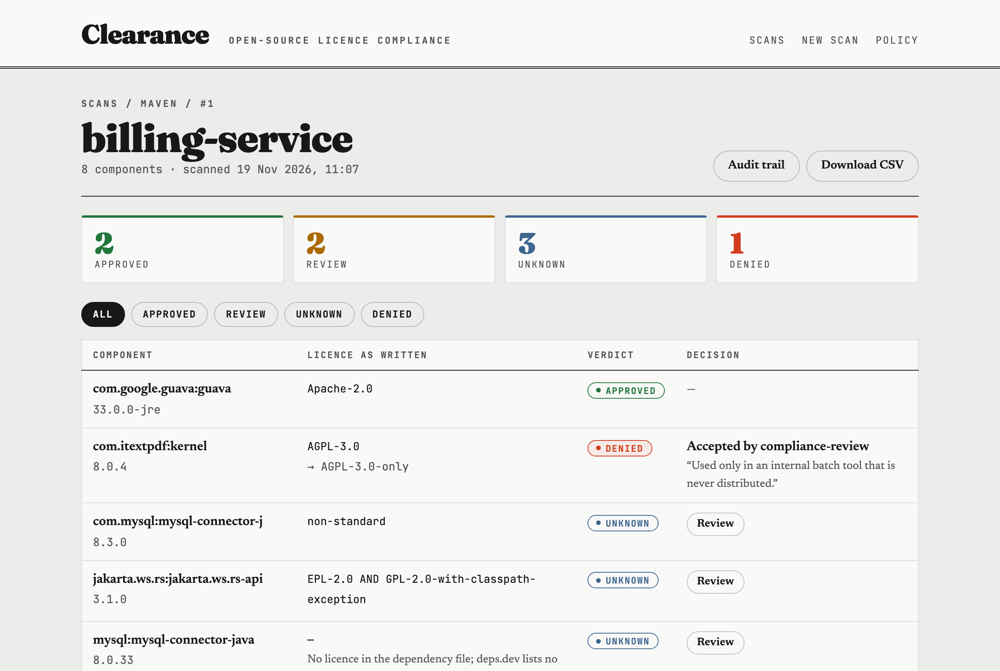
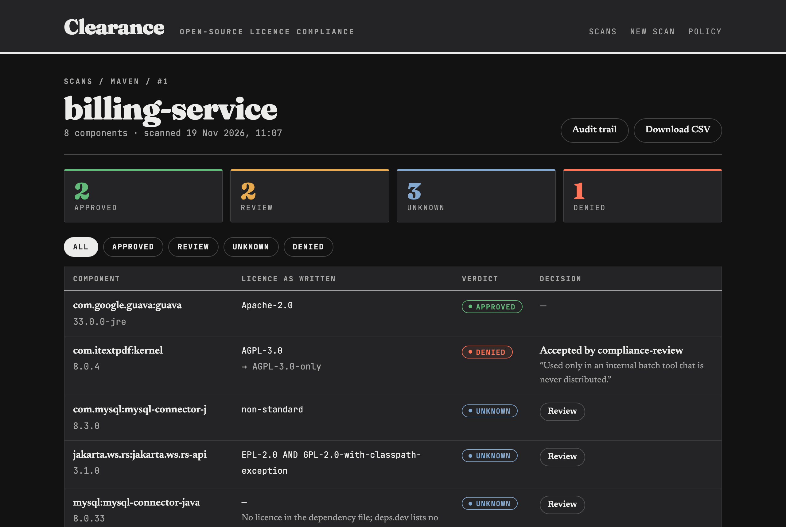
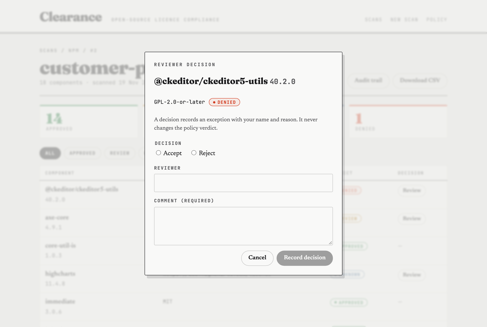
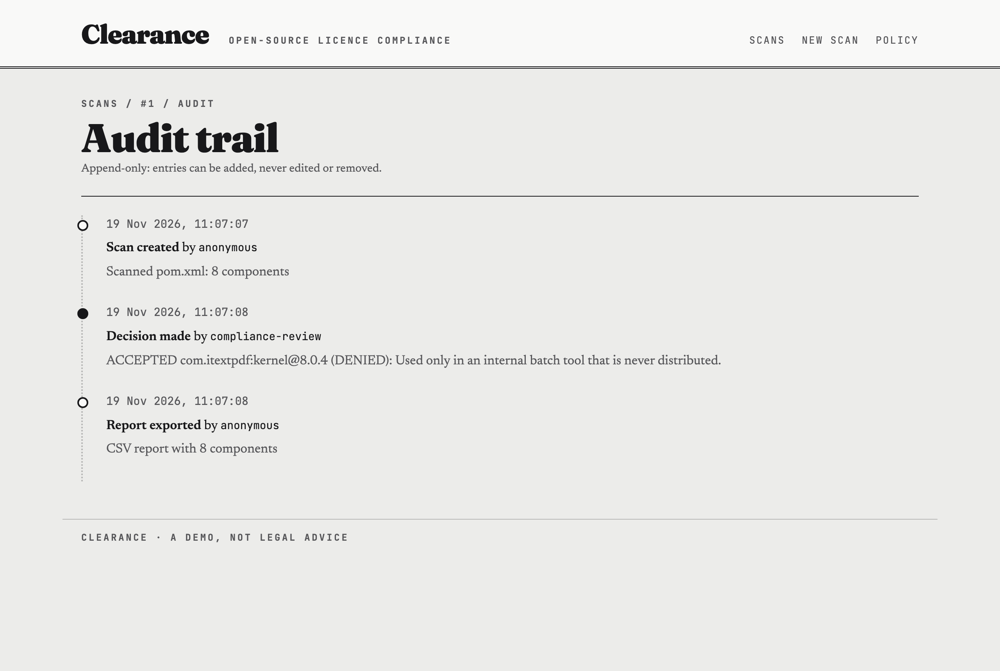
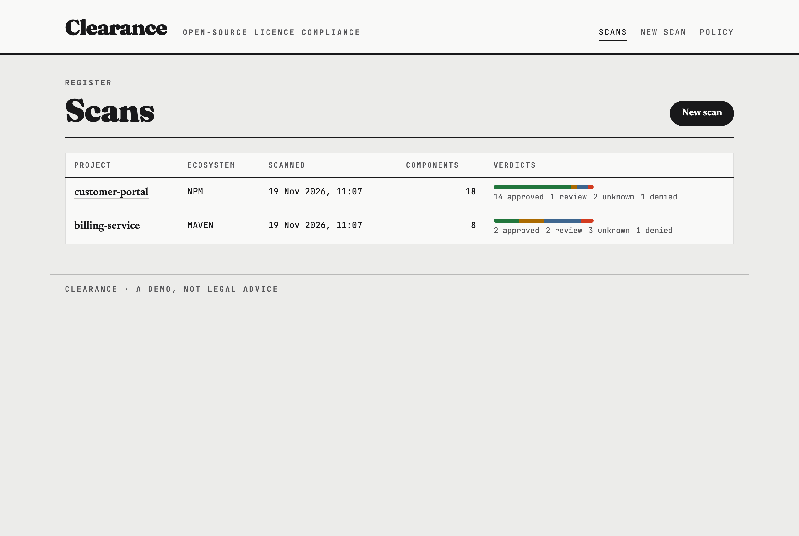
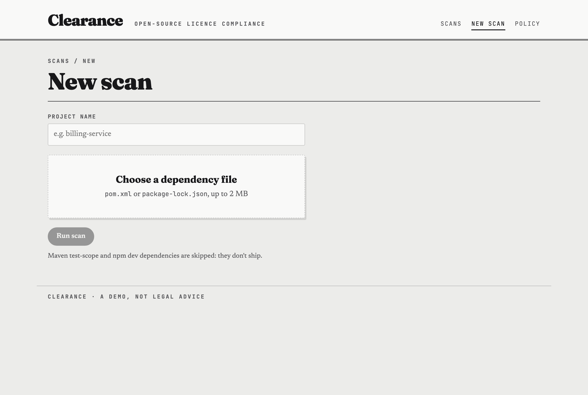

# Build report

The "Report back" section of [SPEC.md](../SPEC.md), answered.

## Repo

<https://github.com/tejalgoyal2/clearance> (public). CI runs on every push to `main` and covers backend tests, frontend tests and a Docker + Playwright run.

## "Done means"

| Item | Status | Evidence |
|---|---|---|
| `docker compose up` starts Postgres, API and UI with no other setup | Done | Healthcheck-gated startup; CI runs `docker compose up --wait` |
| Each sample produces APPROVED, REVIEW, UNKNOWN and DENIED | Done | `pom.xml`: 2 / 2 / 3 / 1. `package-lock.json`: 14 / 1 / 2 / 1. Both checked live; see [samples/EXPECTED.md](../samples/EXPECTED.md) |
| A reviewer accepts or rejects with a comment, and the audit view shows who decided what, and when | Done | Playwright journey test; screenshot below |
| The CSV report downloads | Done | Playwright download test |
| Backend, frontend and end-to-end tests pass locally and in CI | Done | See the test counts below |
| The README explains the project in under a minute | Done | [README.md](../README.md) |

## Test counts

| Suite | Tests |
|---|---|
| Backend unit (SPDX parser, policy engine, parsers, resolvers, CSV) | 112 |
| Backend controllers (MockMvc) | 18 |
| Backend integration (Testcontainers PostgreSQL) | 10 |
| Frontend (Vitest) | 25 |
| End to end (Playwright) | 2 |
| **Total** | **167** |

Every backend and frontend suite was written before its code. The first run was red: 88 of 89 failing in phase 1, 31 of 32 in phase 2, and 25 of 25 in the frontend. The two Playwright tests were written after the UI existed.

## Performance (measured)

- Policy engine: about 1.15 million licence verdicts per second on one core (0.87 µs each).
- npm lockfile parser: about 120,000 lockfiles per second.

## Screenshots

| | |
|---|---|
|  |  |
|  |  |
|  |  |

The policy page is in [screenshots/policy.png](screenshots/policy.png). To regenerate the screenshots, start the stack and run `node e2e/screenshot.mjs` from the `e2e` folder.

## Cut or changed

- **No public deployment.** The stack runs locally with Docker Compose.
- **No real `WITH` sample.** No real package reports a literal `X WITH Y` licence on deps.dev, so `WITH` is covered by unit tests only. `com.mysql:mysql-connector-j` reports `non-standard`, not the expression the spec expected.
- **npm `dev` packages are skipped.** The spec only says to skip Maven test scope; this applies the same reasoning, since dev packages don't ship.
- **The policy adds `-or-later` variants.** GPL and AGPL `-or-later` are denied and LGPL `-or-later` is review, so they don't fall through to UNKNOWN.
- **Multiple licences from deps.dev are joined with `AND`.** This is the conservative reading. Real dual licences (`OR`) are listed under "What's next" in the README.
